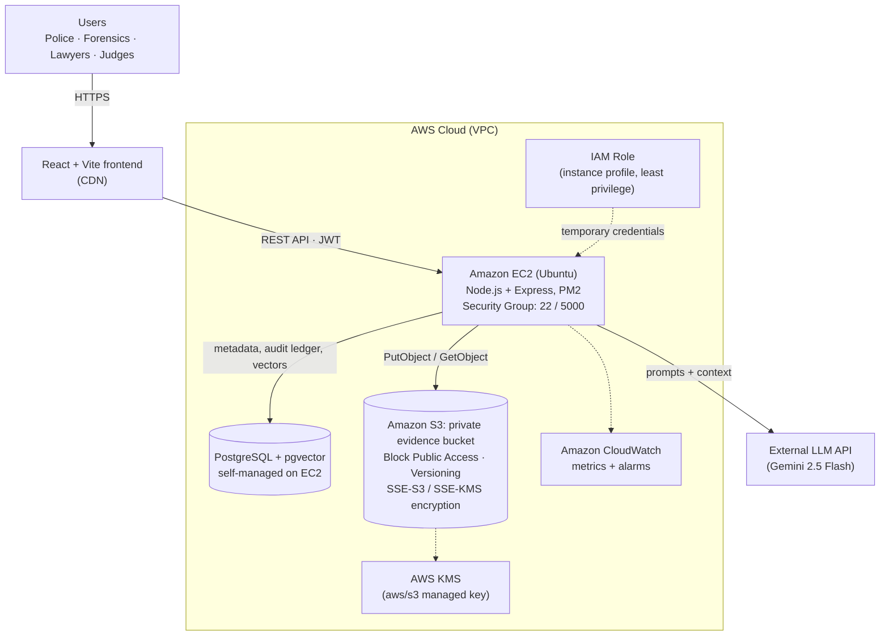

# NyayVault: Cloud-Native Digital Evidence Vault on AWS


**Live:** <https://nyayvault.in>

NyayVault is a secure, cloud-hosted digital evidence management system for police, forensic labs,
lawyers and courts. Evidence files (FIRs, forensic reports, court orders, media) are stored in a
private **Amazon S3** vault, the API runs on **Amazon EC2**, and every file is SHA-256 hashed on
upload so any tampering is detected the moment it is opened.

> Course project for **UCS531 Cloud Computing**. NyayVault began as a hackathon prototype; this
> version re-architects it as a cloud-native application on AWS.

---

## ☁️ AWS Architecture



| AWS service | How NyayVault uses it |
|---|---|
| **Amazon EC2** | Hosts the Node.js/Express API (managed by PM2) and the PostgreSQL + pgvector database. Security Group allows only SSH (22) and the API port. |
| **Amazon S3** | The evidence vault. Private bucket with Block Public Access, versioning (old versions are kept, so evidence can't be silently overwritten), and server-side encryption. Objects use random, case-scoped keys: `cases/<caseId>/documents/<docId>/<file>`. |
| **AWS IAM** | The EC2 instance assumes an IAM role (instance profile) scoped to just this bucket, so **no AWS access keys are stored on the server**. |
| **AWS KMS** | Files marked *Sensitive Medical / Forensic* are encrypted with SSE-KMS (AWS-managed `aws/s3` key); all other files use SSE-S3 (AES-256). |
| **Amazon CloudWatch** | EC2 CPU / network / status-check metrics and an alarm on instance health. |

`GET /api/health` reports the live storage driver (`Amazon S3`), bucket, region, and auth mode
(`IAM role (instance profile)`). The Settings page in the app shows the same information.

AWS setup steps (bucket, IAM role, CloudWatch) are in **[docs/AWS_SETUP.md](docs/AWS_SETUP.md)**.

---

## ✨ Features

- **Role-Based Access Control:** investigators, forensic examiners, prosecutors, defence counsel,
  registrars and judges each see only the evidence they are authorised for.
- **Cryptographic chain of custody:** SHA-256 on upload, live re-hash of the S3 object on every
  access, and an append-only audit ledger of every upload, view, download and redaction.
- **Tamper demo:** flip one byte of a stored S3 object and watch the integrity check turn red, then restore it.
- **AI document intelligence:** OCR, automatic document classification, and PII detection/redaction
  (the redacted copy is a new S3 object; the original and its hash stay unchanged).
- **Case assistant (RAG):** questions are answered only from the case's own documents, using
  pgvector semantic search.

## 🧱 Tech Stack

| Layer | Technology |
|---|---|
| Frontend | React 18, Vite, Tailwind CSS |
| API | Node.js 20, Express, JWT, Multer, PM2 on **AWS EC2** |
| Object storage | **Amazon S3** via AWS SDK v3 (`@aws-sdk/client-s3`) |
| Database | PostgreSQL 16 + pgvector (embedded PGlite fallback for local dev) |
| AI | Gemini 2.5 Flash (Google AI Studio or OpenRouter), Tesseract OCR |

---

## 🚀 Running Locally

Local development uses **MinIO** as an S3-compatible stand-in, so the same storage code runs
against real S3 in production.

```bash
# everything in Docker (Postgres + MinIO + API + frontend)
docker compose up --build
# frontend: http://localhost:5173   API: http://localhost:5001   MinIO console: http://localhost:9001
```

Or run it manually:

```bash
cd server && npm install && cp .env.example .env && node src/server.js
cd client && npm install && npm run dev
```

Demo logins: badges `POL-1`, `JUD-1`, `ADV-1`, `ADV-2`, `REG-1` with password `nyay2026`
(there's also a quick-fill button on the login page).

## 🚢 Deploying to AWS

1. Create the S3 bucket and IAM role ([docs/AWS_SETUP.md](docs/AWS_SETUP.md)).
2. On EC2, set these in `~/server/.env`: `AWS_REGION`, `AWS_S3_BUCKET_NAME`, `DATABASE_URL`, `JWT_SECRET`, and
   the AI key. Leave `AWS_ACCESS_KEY_ID` / `AWS_SECRET_ACCESS_KEY` / `AWS_S3_ENDPOINT` **unset** so the IAM role is used.
3. From your machine:
   ```powershell
   $env:EC2_KEY_PATH = "C:\path\to\key.pem"; $env:EC2_HOST = "ubuntu@<ec2-ip>"
   ./deploy_backend.ps1
   ```
4. Copy any evidence that was saved on the EC2 disk into S3: `node scripts/sync_local_to_s3.js` (run on EC2).

## 🛡️ Security

- S3 bucket is private, has Block Public Access on, and encrypts everything at rest. The browser never gets a direct S3 URL; files are streamed through the API after an RBAC check.
- No long-lived AWS keys on the server (IAM instance role).
- JWTs expire after 24 h. Maintenance endpoints (`/api/dev/*`) only work from the EC2 host itself or with an admin key.
- Evidence records are append-only. Redaction creates a new object and never overwrites the original.

## 📁 Repository Layout

```
client/           React frontend
server/           Express API (src/storage/s3Client.js = S3 integration)
server/scripts/   migrations + local-disk → S3 sync
docs/             AWS setup guide
demo_data/        sample case documents for the demo
archive/          earlier hackathon material and one-off scripts (not used by the app)
```

## 📄 License

MIT
